<picture><source media="(prefers-color-scheme: dark)" srcset="assets/hero-dark.svg"></picture>

<picture><source media="(prefers-color-scheme: dark)" srcset="assets/stack-dark.svg"></picture>

<a href="https://github.com/j5nya/SoneroFpsUnlocker"><picture><source media="(prefers-color-scheme: dark)" srcset="assets/project-sonerofpsunlocker-dark.svg"></picture></a> <a href="https://github.com/j5nya/ECBootstraper"><picture><source media="(prefers-color-scheme: dark)" srcset="assets/project-ecbootstraper-dark.svg"></picture></a>

<picture><source media="(prefers-color-scheme: dark)" srcset="assets/stats-dark.svg"></picture>

<picture><source media="(prefers-color-scheme: dark)" srcset="assets/languages-dark.svg"></picture> <picture><source media="(prefers-color-scheme: dark)" srcset="assets/streak-dark.svg"></picture>

